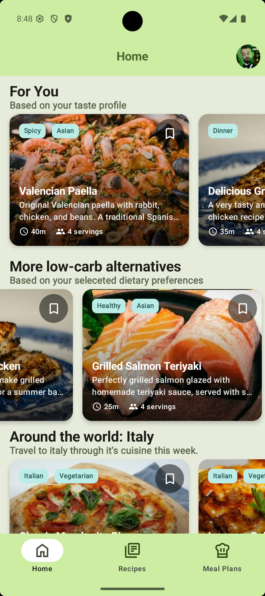
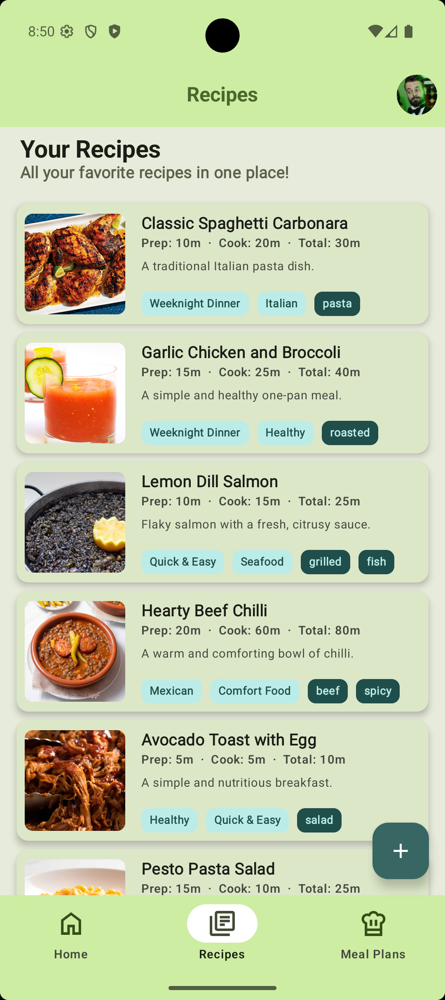
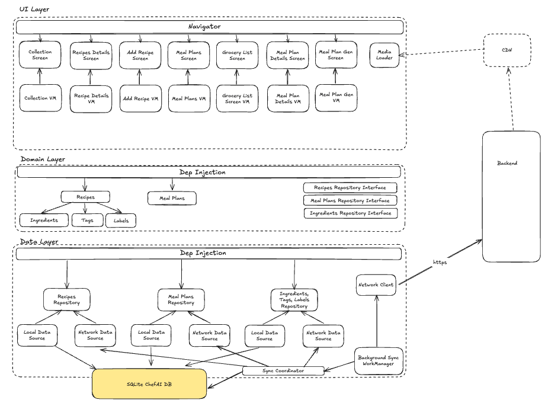

# Chef AI

[](https://github.com/jmuci/ChefAI/actions/workflows/unit_tests.yml)

ChefAI is a Kotlin-first Android app that allows users to manage their own recipe collection. It also provides a library of recipes for users to browse and save. The app can generate weekly meal plans based on user preferences like low-carb, vegan, or Mediterranean diets, and allows for customization of the meal plan. Additionally, ChefAI can export the list of ingredients needed for a meal plan to a grocery store for purchase or provide a simple grocery list.

## Installation

Open with Android Studio.

## Usage

This project is still under development.

# Documentation

* [Authentication](docs/authentication.md)

See the [docs folder](docs/)

## UI Preview

Below are a couple of the app screens to get an idea of how it looks. 

| Home Screen | MyCollection Screen |
|------------|----------------------|
|  |  |


## Overall architecture


### 🏗️ Architecture Overview

ChefAI follows a Clean Architecture with an offline-first design.

UI Layer – Jetpack Compose screens with ViewModels that interact only with domain use cases.

Domain Layer – Pure Kotlin business logic, entity models, and repository interfaces.

Data Layer – Dual-source repositories combining Room (SQLite) for local caching and a Ktor network client for backend access.

Sync – Planned: Background WorkManager will handle two-step sync (push local outbox → pull backend deltas). Not yet implemented.

IDs & Storage – All entities use client-generated, time-sortable UUIDv7 IDs; Room provides full-text search and ACID transactions.

Dependency Injection – Hilt modules wire DAOs, network clients, and repositories.

This structure keeps UI reactive, data consistent across devices, and the codebase modular, testable, and ready to scale.
## Chosen Libraries

Dependency Injection:
* [Hilt](https://developer.android.com/training/dependency-injection/hilt-android)

Data Base Layers:
* [Room](https://developer.android.com/training/data-storage/room)

Android UI:
* [Jetpack Compose](https://developer.android.com/jetpack/compose)
* [Navigation Compose](https://developer.android.com/jetpack/compose/navigation)
* [Material 3](https://m3.material.io/)
* [Lifecycle/ViewModel](https://developer.android.com/topic/libraries/architecture/lifecycle)

Image Loading:
* [Coil](https://github.com/coil-kt/coil)

Networking: 
* [Ktor](https://ktor.io/docs/welcome.html) with CIO engine, content negotiation, and logging
* [Kotlinx Serialization](https://github.com/Kotlin/kotlinx.serialization)

Coroutines:
* [Kotlinx Coroutines](https://github.com/Kotlin/kotlinx.coroutines)

Utils:
* [Timber](https://github.com/JakeWharton/timber)
* [SLF4J](http://www.slf4j.org/) and [Logback](https://logback.qos.ch/) for Ktor logging

## UI Tests (Maestro)

End-to-end UI flows live in [`.maestro/`](.maestro/) and run with [Maestro](https://maestro.mobile.dev)
(open-source, free to run locally and on your own CI).

| Flow | What it checks | Needs backend |
|------|----------------|---------------|
| `smoke/anonymous_tab_navigation.yaml` | A fresh, anonymous install can reach every bottom-nav tab | No |
| `auth/register_logout_login.yaml` | Registers a throwaway account, logs out, logs back in | Yes |
| `recipes/save_recipe_from_search.yaml` | Saves a search result and finds it in the Recipes tab | Yes |
| `mealplans/generate_meal_plan.yaml` | Walks the wizard and gets a filled 5-day plan | Yes |

**Setup**

1. Install the Maestro CLI:
   ```bash
   curl -fsSL "https://get.maestro.mobile.dev" | bash
   ```
2. Start an emulator (or connect a device) and install the debug build:
   ```bash
   ./gradlew :app:installDebug
   ```
3. For the flows tagged `backend`, run the [backend](https://github.com/jmuci/Chef.ai_Backend) locally on
   port 8080 — the debug build talks to `http://10.0.2.2:8080`, the host's localhost seen from the
   emulator. Search and meal-plan generation need public recipes in its database.

**Running**

```bash
maestro test .maestro                          # every flow
maestro test --exclude-tags backend .maestro   # only the flows that work offline
maestro test .maestro/smoke                    # one folder
```

Every flow starts from `clearState`, so it wipes the app's local data on the device it runs on.
`maestro studio` opens an interactive inspector that helps when writing new flows.

## Backend Test End Points

You can use the enpoints hosted in this repo to test the backend:
https://github.com/jmuci/ChATestAPI/tree/main?tab=readme-ov-file

## Contributing

Pull requests are welcome. For major changes, please open an issue first
to discuss what you would like to change.

Please make sure to update tests as appropriate.
