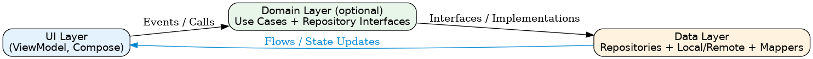
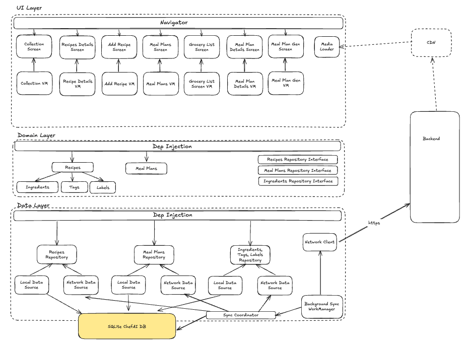
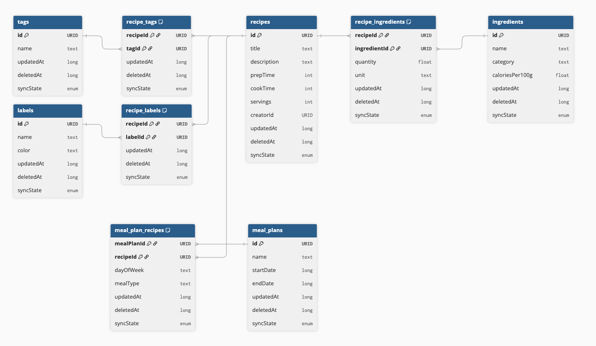

# ChefAI Architecture Overview

_Last updated: November 2026_

ChefAI follows a **Hybrid Architecture** based on Google’s Modern Android Architecture, selectively enhanced with **Clean Architecture principles**.  
The goal is to balance **developer velocity** (for a solo engineer) with **clarity, testability, and scalability** for future growth or collaboration.

---

## 🧩 Layer Overview

```
                UI (Compose, ViewModels)
                            ↓
Domain (Use Cases, Domain Entities, Repository Interfaces)
                            ↓
 Data (Repository Implementations, Local/Remote, Mappers)
```





### UI Layer
- Uses Jetpack Compose and `ViewModel` with `StateFlow` for state management.
- Emits **UI events** upward and receives **state updates** downward.
- Contains no data logic or persistence dependencies.

### Domain Layer
- Optional layer used when logic grows in complexity or reuse.
- Holds:
    - **Domain models (entities)** — pure Kotlin, representing business meaning.
    - **Use Cases** — reusable, testable orchestration of repositories or domain logic.
    - **Repository interfaces** — abstractions implemented in the Data layer.
- Free of Android or I/O dependencies.

### Data Layer
- Contains repository implementations, data sources (Room, Ktor), DTOs, and mappers.
- Owns the **single source of truth** for persisted or cached data.
- Responsible for coordinating between network, local storage, and mapping to/from domain.

### BE Sync Mechanism 


```
┌──────────────────────────────────────────────────┐
│                    UI Layer                       │
│  Compose Screens ← ViewModel ← StateFlow/Paging  │
└──────────────────────┬───────────────────────────┘
                       │ observes
┌──────────────────────▼───────────────────────────┐
│                 Domain Layer                      │
│  Repository interfaces, Use Cases, Domain Models  │
└──────────────────────┬───────────────────────────┘
                       │ implements
┌──────────────────────▼───────────────────────────┐
│                  Data Layer                       │
│                                                   │
│  ┌─────────────┐    ┌──────────────┐             │
│  │  Room (SSOT) │    │ Ktor Client  │             │
│  │  23 entities │    │ Auth + Sync  │             │
│  │  sync_meta   │    │ endpoints    │             │
│  └──────┬──────┘    └──────┬───────┘             │
│         │                   │                     │
│         └───────┬───────────┘                     │
│                 │                                 │
│         ┌───────▼────────┐                        │
│         │  SyncWorker    │                        │
│         │  (WorkManager) │                        │
│         │  Push → Pull   │                        │
│         └────────────────┘                        │
│                                                   │
│  SessionManager (Anonymous | Authenticated)       │
└───────────────────────────────────────────────────┘
```




> ⚠️ The two images above are stale (last regenerated when the DB had ~8 tables and the app had far
> fewer screens than it does now). [`img/architecture-diagram-2025.md`](img/architecture-diagram-2025.md)
> is a Mermaid source that's closer to current — treat it as the fallback until these PNGs are
> regenerated.

### Implementation facts (Nov 2026)

Feature status lives in CLAUDE.md's [Current Gaps](../CLAUDE.md) table (one line per area) and
[feature-status.md](feature-status.md) (detail for areas without an ADR) — this file keeps the
structural facts that change rarely:

- **Room:** 23 entities, schema v16, migrations `MIGRATION_1_2` … `MIGRATION_15_16`, schemas exported
  to `app/schemas/`. No FTS tables; no Paging 3 (lists are `Flow<List<…>>`, bounded with `LIMIT`).
- **Network:** Ktor with the **OkHttp** engine (not CIO — see `NetworkModule`), kotlinx JSON, an
  `AuthInterceptor` on the default client and a separate unauthenticated `@ScraperHttpClient`.
- **Sync:** `SyncWorker` → `SyncOrchestrator`, push then pull — [ADR-006](adrs/adr-006-sync-protocol.md).
- **Session:** `SessionManager` exposes `UserSession` (`Loading` / `Anonymous` / `Authenticated`).
- **Modules:** `:app` and the pure-Kotlin `:recipe-scraper`.

---

## 🔄 Unidirectional Data Flow (UDF)

```
UI → Domain → Data
↑               ↓
--< State Flow <--
```

- **Events flowdown from UI → Domain → Data** user actions, triggers, or intents.
- **State flows up from Data → Domain → UI** data updates or UI models emitted via `Flow`/`StateFlow`.
- Each data type has a **single source of truth** (usually a repository).

---

## 🧱 Entities and Models

| Layer | Type | Example | Notes |
|-------|------|----------|-------|
| Domain | Entity / Business Model | `Recipe` | Core business truth |
| Network | DTO | `RecipeResponse` | Mirrors API schema |
| Database | Persistence Model | `RecipeEntity` | Matches Room table |
| UI | UI Model | `RecipeUi` | Tailored for presentation |

Mappers convert between these layers under `data/mapper/` and `ui/mappers/`.

---

## ⚙️ Dependency Direction

`UI → Domain → Data`

- Domain defines interfaces; Data implements them.
- No Android or storage dependencies are allowed in the Domain layer.
- ViewModels and UseCases are constructed via dependency injection (Hilt).

---

## ✅ Design Principles

- **Simplicity First:** introduce layers only when needed.
- **Testability:** all business logic must be unit-testable without Android.
- **Separation of Concerns:** UI, business rules, and data persistence stay isolated.
- **Explicit Data Flow:** no mutable shared state across layers.
- **Evolution-friendly:** easily migrate to multi-module (e.g. `:domain`, `:data`) if app grows.

---

## 📄 Related Documents

- [`/CLAUDE.md`](../CLAUDE.md) — project instructions and the actively-maintained Current Gaps table.
- [`/docs/adrs/adr-001-hybrid-architecture-choice.md`](adrs/adr-001-hybrid-architecture-choice.md) — rationale for choosing this hybrid architecture.
- [`/docs/adrs/adr-002–local-DB-choice-and-ID-gen.md`](adrs/adr-002–local-DB-choice-and-ID-gen.md) — SQLite/Room + UUIDv7.
- [`/docs/adrs/adr-0005-feature-based-package-structure.md`](adrs/adr-0005-feature-based-package-structure.md) — Feature-based packaging.
- [`/docs/adrs/adr-006-sync-protocol.md`](adrs/adr-006-sync-protocol.md) — current sync protocol (push/pull, conflicts, triggers); its History section absorbs ADR-003 and ADR-004 (data layer).
- [`/docs/adrs/adr-007-anonymous-first.md`](adrs/adr-007-anonymous-first.md) — anonymous-first account model.
- [`/docs/adrs/adr-008-data-handling-across-sessions.md`](adrs/adr-008-data-handling-across-sessions.md) — logout/account-switch data handling.
- [`/docs/adrs/adr-009-navigation-scoped-viewmodel-for-wizards.md`](adrs/adr-009-navigation-scoped-viewmodel-for-wizards.md) — nav-graph-scoped ViewModel for wizards.
- [`/docs/adrs/adr-010-client-side-recipe-scraping.md`](adrs/adr-010-client-side-recipe-scraping.md) — `:recipe-scraper` module and the URL-import fetch pipeline.
- [`/docs/adrs/adr-012-recipe-image-upload.md`](adrs/adr-012-recipe-image-upload.md) — recipe images: on-device cache, cross-device sync and upload (absorbs ADR-011).
- ADR-013 to ADR-018 — units, households, week view, recipe language, cook history, saved plans; see the [ADR index](claude/decisions.md).
- [`/docs/sync-deep-dive.md`](sync-deep-dive.md) — step-by-step sync flow, scenarios, and a manual testing checklist.
- [`/docs/pocket-chef-sdui-guide.md`](pocket-chef-sdui-guide.md) — see the disclaimer at the top before using this one; it does not describe the shipped implementation.
- [`/docs/authentication.md`](authentication.md) — Auth system documentation.
- [`/docs/feature-status.md`](feature-status.md) — implementation detail for features without an ADR.
- [`/docs/archive/`](archive/) — one-off implementation prompts and plans, kept for history only.